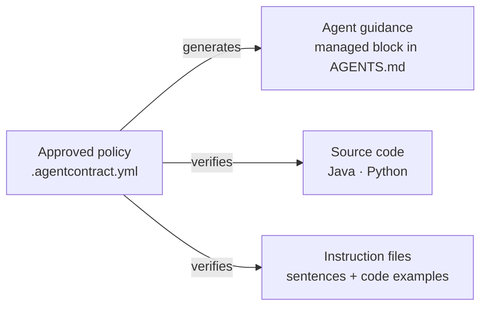
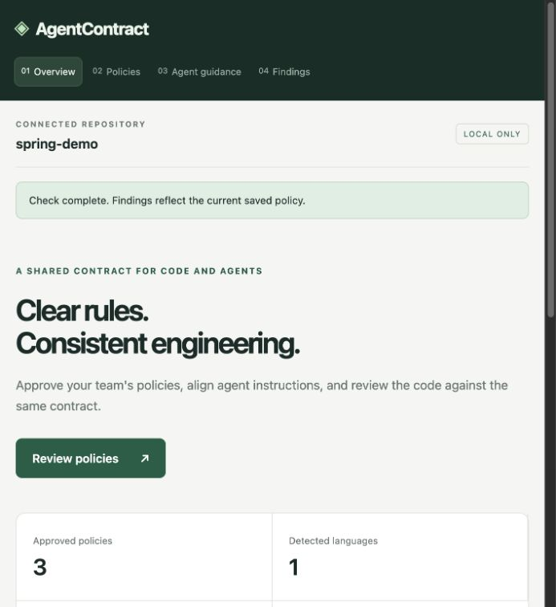
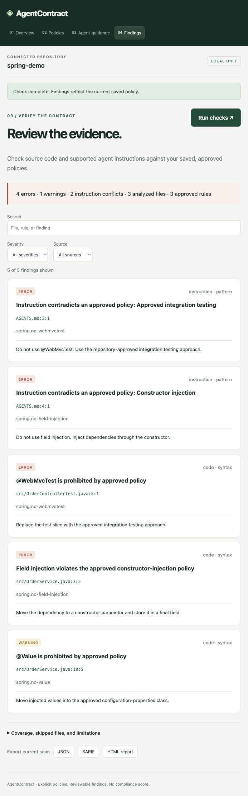

# AgentContract

**Your team's engineering rules, enforced in the code *and* in the instructions you give AI coding agents.**

[](https://github.com/rrezartprebreza/agent-contract/actions/workflows/ci.yml)
[](LICENSE)


Coding agents follow `AGENTS.md`, `CLAUDE.md`, and `SKILL.md` files, not your wiki. When those files drift from the rules your team agreed on, agents faithfully produce the code you were trying to prevent. AgentContract keeps three things in agreement:



It is free, MIT-licensed, and fully local: no account, no AI API key, no uploads.

## What it catches

| Your team decided… | …but an instruction file says | …or the code does |
| --- | --- | --- |
| Constructor injection only | `Prefer field injection for services.` | `@Autowired private Store store;` |
| No `@WebMvcTest` slices | a code example annotated `@WebMvcTest` | `@WebMvcTest class OrderControllerTest` |
| Typed configuration | ```` ```java ```` example using `@Value("${url}")` | `@Value("${payments.url}") String url;` |
| *Your own rule*, e.g. no Lombok `@Data` | `Use @Data for DTOs.` | `@Data public class Money` |

## See it in 60 seconds

```sh
git clone https://github.com/rrezartprebreza/agent-contract.git && cd agent-contract
python3 -m venv .venv && .venv/bin/python -m pip install .
.venv/bin/agentcontract check examples/spring-demo
```

```text
ERROR AGENTS.md:3:1 [spring.no-webmvctest; instruction] Instruction contradicts an approved policy: Approved integration testing
ERROR AGENTS.md:4:1 [spring.no-field-injection; instruction] Instruction contradicts an approved policy: Constructor injection
WARNING AGENTS.md:18:5 [spring.no-value; instruction] Code example teaches a pattern the approved policy prohibits: Typed configuration
WARNING src/Money.java:5:1 [custom.no-lombok-data; code] @Data is prohibited by approved policy
ERROR src/OrderControllerTest.java:5:1 [spring.no-webmvctest; code] @WebMvcTest is prohibited by approved policy
ERROR src/OrderService.java:7:5 [spring.no-field-injection; code] Field injection violates the approved constructor-injection policy
WARNING src/OrderService.java:10:5 [spring.no-value; code] @Value is prohibited by approved policy
7 finding(s) · 4 files analyzed · 1 excluded by policy · 4 approved rules
```

The demo deliberately contains every kind of finding: two conflicting instruction sentences, a code example that teaches a prohibited pattern, a custom rule, code violations, and a legacy directory excluded by the policy scope. Its AGENTS.md also contains a ❌ counter-example, which is correctly **not** flagged. The demo files are analysis fixtures, not a runnable Spring application.

## The local app

```sh
.venv/bin/agentcontract serve examples/spring-demo
```

Open the complete URL the command prints; it carries a per-session token. Four screens walk through the workflow: repository overview, explicit policy approval, agent-guidance preview and update, and findings with search, filters and JSON/SARIF/HTML export.

| Overview | Findings |
| --- | --- |
|  |  |

<sub>Screenshots from 0.3, before code-example findings, custom rules, and policy scopes were added.</sub>

The server binds only to `127.0.0.1` and to the repository chosen at startup; use `--port 0` for a free port and Ctrl+C to stop. `./run.sh examples/spring-demo` does the same after installation.

## Use it on your repository

```sh
.venv/bin/agentcontract init /path/to/project    # proposes rules, all with approved: false
.venv/bin/agentcontract serve /path/to/project   # approve the conventions your team wants
.venv/bin/agentcontract check /path/to/project
```

Nothing becomes blocking just because it is available: a rule runs only after someone approves it, and the starter catalog is never inferred from your code. Then preview the generated guidance and write it into AGENTS.md's managed section. Handwritten instructions are preserved even when they conflict; findings point at those lines for a human to correct.

## Adopt on an existing codebase

A real repository usually has violations on day one. Record them once, and the check fails only on new ones:

```sh
agentcontract baseline .          # writes .agentcontract-baseline.json — commit it
agentcontract check .             # exit 0: existing findings are accepted, reported, not blocking
# …later, after fixing some of them:
agentcontract baseline . --prune  # removes fixed entries; never adds new ones
```

```text
0 finding(s) · 14 accepted by baseline · 127 files analyzed · 143 excluded by policy · 3 approved rules
```

- **Only new violations fail.** A finding is matched by its rule, file, and the text of its own line, so code moving around the file does not reset it, while editing the violating line makes it new: touched code must comply. Identical lines are counted, so a third copy of a twice-accepted violation is still new.
- **It can only shrink.** `baseline` refuses to overwrite an existing file and `--prune` never adds entries, so new violations are never silently absorbed.
- **Nothing is hidden.** Every report states how many findings the baseline accepted and how many entries were fixed; `check --no-baseline` shows everything. Incomplete analysis still exits 2.
- SARIF results carry `baselineState` (`new`/`unchanged`) and stable `partialFingerprints`, so code scanning tracks findings across line moves.

## Policy file

```yaml
version: 1

# Optional: keep teaching examples, generated or frozen code out of scope.
exclude:
  - "**/examples/**"
  - "legacy/**"

# Optional: your own prohibited Java annotations.
custom:
  custom.no-lombok-data:
    title: Explicit data classes
    annotation: lombok.Data             # fully qualified
    guidance: Do not use @Data. Use records or explicit accessors.
    remediation: Replace @Data with a record.   # optional, defaults to guidance
    target: any                         # or "field" to flag only field-level use

rules:
  spring.no-field-injection: {enabled: true, approved: true, severity: error}
  spring.no-webmvctest:      {enabled: true, approved: true, severity: error}
  spring.no-value:           {enabled: true, approved: false, severity: warning}  # proposed: does not run
  custom.no-lombok-data:     {enabled: true, approved: true, severity: warning}
```

| Key | Meaning |
| --- | --- |
| `rules` | Built-in or custom rule IDs with `enabled`, `approved`, and `severity` (`error` blocks, `warning` reports). |
| `exclude` | Repository-relative globs. `*` and `?` stay within one path segment, `**` spans segments. Every report states how many files were excluded, so a narrowed scope is never silent. |
| `custom` | Team-defined rules; IDs look like `custom.no-lombok-data`. They get the same import-aware code check, instruction-sentence check, code-example check, and generated guidance as built-in rules. |

The schema is strict: unknown keys and rule IDs, invalid severities or globs (absolute paths, `..`, duplicates), duplicate YAML keys, anchors/aliases, and unsupported versions are rejected. Policies from 0.1/0.2 (`.agentcontract.toml`) are still read and treated as approved; saving through the app writes `.agentcontract.yml`, which takes precedence. Policies represent team choices: neither `@WebMvcTest` nor `@Value` is universally wrong.

## Built-in rules

| Rule | What is checked |
| --- | --- |
| `spring.no-field-injection` | Field-level Spring `@Autowired` and Jakarta/Javax `@Inject`/`@Resource`. Constructor and setter injection pass, and **test classes are exempt** (a class annotated `@SpringBootTest`, `@WebMvcTest`, `@DataJpaTest`, `@ExtendWith`, … or with JUnit `@Test` methods), because field injection is idiomatic there. |
| `spring.no-webmvctest` | Spring Boot `@WebMvcTest`, for both the Boot 3 and Boot 4 packages. |
| `spring.no-value` | Spring `@Value`. Lombok's `@Value` is a different annotation and is not flagged. |
| `python.no-mutable-defaults` | List/dict/set literal defaults, using the Python AST. |
| `python.require-type-hints` | Missing parameter or return annotations, exempting `self`/`cls`. |

`agentcontract rules /path/to/project` lists built-in and custom rules.

## How the analysis works

**Java** is parsed with Tree-sitter, and annotations are resolved like the compiler does: explicit imports and qualified names; otherwise a simple name can only come from a wildcard import or the file's own package. So `@Value` with `import lombok.*;` is provably not Spring's, while genuinely ambiguous names, import-free snippets, and syntax errors are reported as **incomplete analysis** rather than a false clean result. Custom meta-annotations and cross-file resolution are not supported.

**Instruction files** (`AGENTS.md`, `CLAUDE.md`, `SKILL.md`, `copilot-instructions.md`, `*.instructions.md`) are checked two ways:

- **Sentences**: direct affirmative directives such as `Use @WebMvcTest…`, `Prefer field injection…`, `Always use @Data…`, including nested list items. Negative and conditional lines, block quotes, HTML comments, and indented code blocks are skipped. This is deterministic pattern matching, not natural-language understanding.
- **Code examples**: ```` ```java ```` and unlabelled fences are analyzed as Java, because examples teach agents as strongly as prose. A block counts as a counter-example, and is skipped, when its first lines or the two lines before it say ❌, *Bad*, *Wrong*, *Avoid*, *Don't*, *Before*, or *Without*; ✅ or *Good* wins. Example findings are always **warnings** with confidence `example`, so a heuristic never blocks a build on its own.

**Python** uses the standard-library AST; scanned modules are never imported.

Findings carry a `kind` (`code` or `instruction`) and a `confidence` (`syntax`, `pattern`, or `example`). Policies apply repository-wide; instruction precedence between files is not interpreted.

## Agent guidance stays in sync

`agentcontract guidance <path>` previews, and `--write` updates, only the block between these markers in AGENTS.md:

```text
<!-- agentcontract:begin -->
<!-- agentcontract:end -->
```

Text outside the block is preserved. A missing block is appended; malformed or duplicate markers and symlinked targets are refused. Updates are idempotent and atomic.

## In CI

Exit codes are a stable contract:

| Exit | Meaning |
| --- | --- |
| 0 | No blocking violations among configured, supported checks |
| 1 | Approved policy violations not accepted by the baseline |
| 2 | Tool or configuration failure, incomplete analysis, or no approved rules |

**GitHub Actions with code scanning annotations:**

```yaml
name: AgentContract
on: [pull_request]
permissions:
  contents: read
  security-events: write
jobs:
  policy:
    runs-on: ubuntu-latest
    steps:
      - uses: actions/checkout@v7
      - uses: actions/setup-python@v7
        with:
          python-version: "3.13"
      - run: pip install git+https://github.com/rrezartprebreza/agent-contract.git
      - run: agentcontract check . --format sarif --output agentcontract.sarif
      - uses: github/codeql-action/upload-sarif@v4
        if: always()
        with:
          sarif_file: agentcontract.sarif
```

**pre-commit** (pin `rev` to a commit SHA until releases are tagged):

```yaml
repos:
  - repo: https://github.com/rrezartprebreza/agent-contract
    rev: <commit-sha>
    hooks:
      - id: agentcontract
```

Reports: `--format console|json|html|sarif`. `--output` never overwrites an existing file, and the exit code is preserved even when a report was written.

## Command line

```sh
agentcontract init [path]       # propose rules (unapproved)
agentcontract serve [path]      # local app; --port 0 picks a free port
agentcontract check [path]      # --format console|json|html|sarif, --output FILE, --no-baseline
agentcontract baseline [path]   # accept existing findings; --prune removes fixed ones
agentcontract guidance [path]   # preview; --write updates AGENTS.md's managed block
agentcontract rules [path]      # built-in and custom rules
agentcontract scan [path]       # languages, manifests and instruction files found
agentcontract doctor [path]     # versions and policy validity
```

## Trust, privacy, and limits

- **Never runs your code.** No project scripts are executed and scanned Python modules are never imported. No external service or AI model is involved.
- **Symlinks are not followed.** A link to an analyzed file inside the repository, such as `CLAUDE.md -> AGENTS.md`, loses nothing because the target is analyzed at its own path, and links the analysis would never read are ignored. A relevant link that leaves the repository or is broken makes the analysis incomplete.
- **Bounded.** Relevant files over 1 MB, non-UTF-8 files, and parse errors are reported as skipped; scanning stops after 10,000 file entries; build and vendor directories are excluded.
- **Hardened local app.** Per-session token, strict Host/Origin checks, content security policy, and loopback-only binding. It is a local development app, not a hosted multi-user service or a sandbox against hostile concurrent filesystem changes. Stop it when finished.
- Reports can include paths and short evidence; review them before sharing.

This is an early release. TypeScript and C#, convention inference, pull-request diff analysis, and a full plugin contract are future work; see the [roadmap](docs/ROADMAP.md).

## Development

```sh
.venv/bin/python -m unittest discover -s tests -v
```

Tests cover the analyzers and their false positives, policy validation and migration, scopes, custom rules, code-example detection, baselines, guidance preservation, report escaping, SARIF structure, regressions found on real repositories, and real loopback HTTP flows. CI runs them on Linux and macOS with Python 3.12 and 3.13 and checks the CLI exit-code contract against the examples.

See [CONTRIBUTING.md](CONTRIBUTING.md): every rule needs a stable ID, explicit approval, actionable remediation, and positive, negative, and false-positive tests.

## Feedback

Try the demo, then a repository whose policies you know. Report false positives, missing rules, or installation problems in [GitHub Issues](https://github.com/rrezartprebreza/agent-contract/issues) with your OS, Python and AgentContract versions, the relevant policy, a minimal example, and expected versus actual behavior; remove secrets and private code first. The most useful feedback is whether you would keep a check enabled in your daily workflow.

MIT licensed. Dependencies retain their own licenses.
